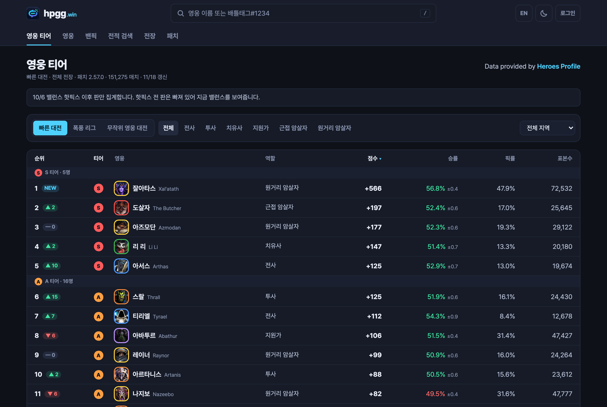
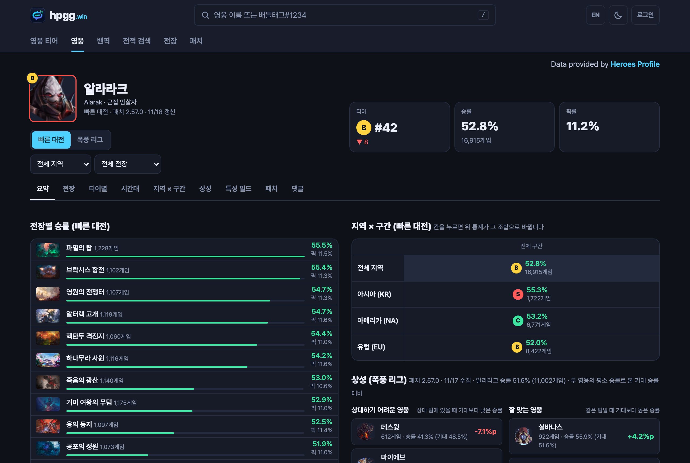
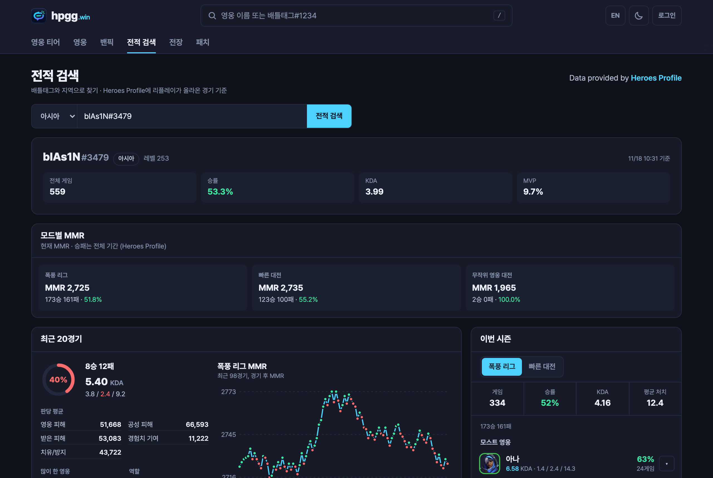
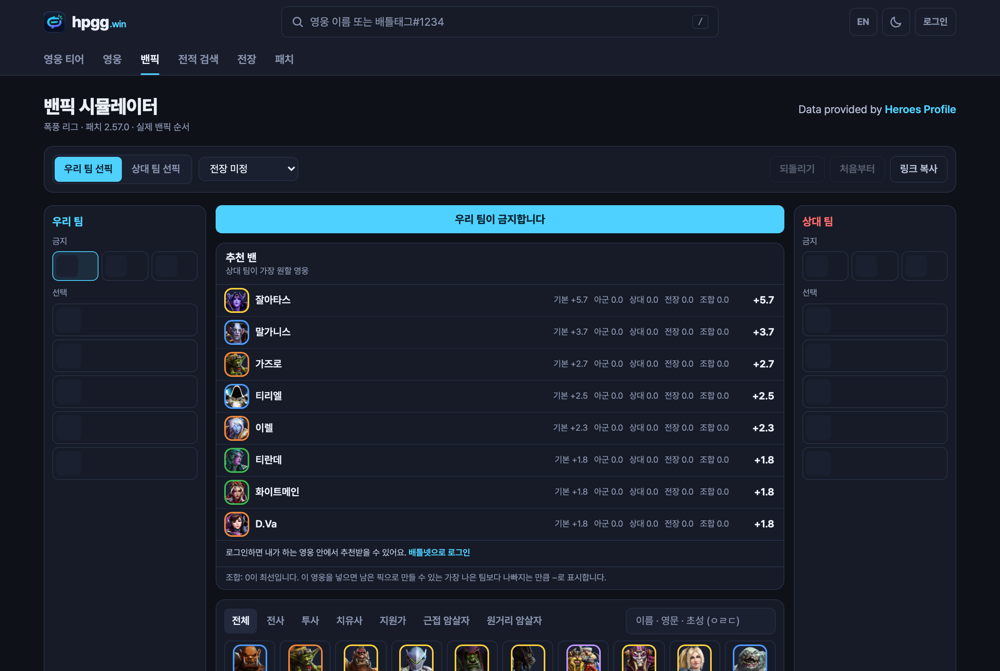
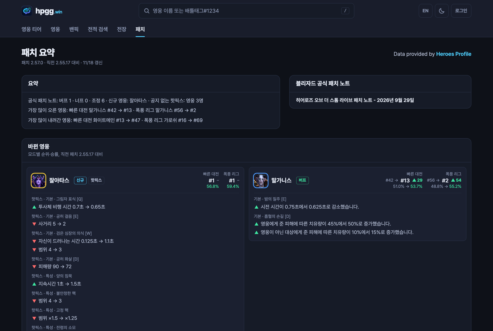
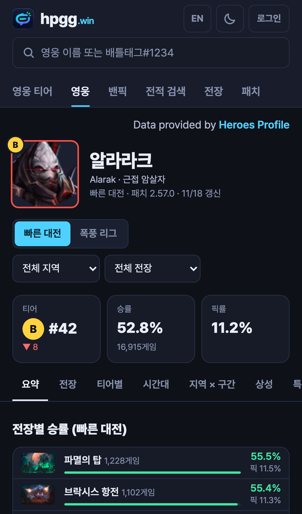
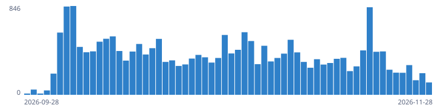

# HPGG (hpgg.win)

A Heroes of the Storm statistics site, in Korean and English, that ran from 2026-09-28 to 2026-11-28. It was shut
down when its owner stopped playing; this repository stays up as a record of how it was built.

> **No match data in this repository.** The site's statistics came from the [Heroes Profile](https://www.heroesprofile.com)
> API, whose terms do not allow passing that data on and require deleting it when the licence ends. The daily
> snapshots were removed from the history at shutdown, and every test fixture that came from Heroes Profile was
> replaced with synthetic data of the same shape (`tools/synth_fixtures.py`): random numbers, fake players.
> Screenshots below were taken from the live site on 2026-11-18.

| Tier list | Hero page | Player search |
|---|---|---|
|  |  |  |
| **Draft simulator** | **Patch notes** | **Phone** |
|  |  |  |

<!-- usage:start -->
## Usage

Live from 2026-09-28 to 2026-11-28 (62 days).

| | |
|---|---|
| Page views | 22,843 (busiest day 2026-10-05: 846; busiest week from 2026-10-05: 3,718) |
| Where from | South Korea 96% |
| Language | Korean 97%, English 3% |
| Device | desktop 74%, phone 25%, tablet 1% |
| Player searches | 1,009 player profiles looked up |
| Battle.net accounts | 17 (sign-in opened 2026-10-30), 3 kept a hero pool |
| Comments | 1 |



Page views are GoatCounter's (one per page per visit, no cookies); searches and accounts are the API's own totals, taken on shutdown day before its database was deleted.
<!-- usage:end -->

## What it did

- **Tier list with the formula on the page.** Quick Match and Storm League, per map, per region and per rank
  bracket. The score shrinks small samples toward 50 % and corrects for party play; the page prints the exact formula
  and its numbers (`web/src/formula.ts`).
- **Hero pages.** Win rate by map, region × bracket, rank tier and game length; counters and synergies measured
  against the expected win rate of the two heroes; popular talent builds sorted by a sample-aware score; buffs and
  nerfs parsed from the official patch notes and from hotfix game files.
- **Draft simulator.** Pick and ban suggestions in the real Storm League draft order, weighing hero strength,
  matchups, map and team make-up; each term's weight was measured on later games.
- **Player search.** Profile, MMR by mode, recent games with full stat lines, single-replay detail, season summary —
  served by a small API with caching and quota budgeting against a tightly rationed upstream.
- **Accounts.** Battle.net OAuth login, a personal hero pool that narrows the draft simulator, per-hero comments.
- **Owner MCP server.** A remote MCP endpoint with owner-only OAuth so ChatGPT could read the owner's own games;
  its Python formulas are pinned to the TypeScript ones through shared golden fixtures.
- Korean and English from one route tree, a light theme, every page checked for WCAG AA contrast.

## How it was built

| Part | Stack |
|---|---|
| `collector/` | Python 3.11+, httpx, asyncio. A daily job (dispatched from a Mac mini, GitHub Actions as fallback) that collects within the API's weekly quota, writes JSON atomically and commits it. |
| `web/` | Next.js 16 static export, React 19, Tailwind 4, deployed to GitHub Pages on every push. |
| `server/` | FastAPI, SQLAlchemy (async SQLite), Alembic, structlog; Docker on a Mac mini behind a Cloudflare tunnel. Player search, accounts, comments, MCP. |
| `tools/` | Game-data builders (talents, awards, hero tables from HeroesToolChest) and hotfix diffing of the game's own files. |

Engineering habits that held for the whole project: test first, unit tests on both sides (pytest about 630,
vitest about 500), Playwright end-to-end tests over the static export (about 250, including contrast checks for both
themes at two widths), strict mypy and ruff in CI, and design notes for every larger decision in `docs/`.

## Run it locally

```bash
uv sync && uv run pytest                    # collector + server
cd web && npm ci && npm test                # unit tests
npm run e2e                                 # builds against the synthetic data in web/tests/e2e-data
DATA_DIR=tests/e2e-data npm run dev         # browse the site on synthetic data at http://localhost:5173/ko/hots/
```

The collector and the API need a Heroes Profile API key (`.env.example`); without one, everything above still runs
on the synthetic fixtures.

## Docs

`docs/DESIGN-*.md` are the design notes in order, `docs/HANDOFF.md` the operating notes, `docs/ROADMAP.md` what was
planned and dropped, and `docs/SHUTDOWN-2026-11-28.md` how the service was shut down.
